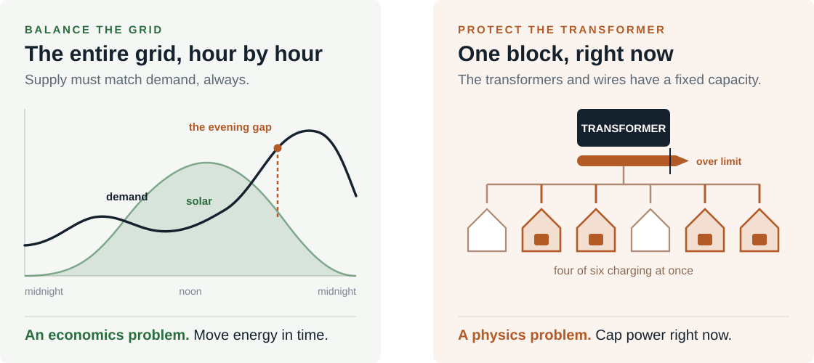
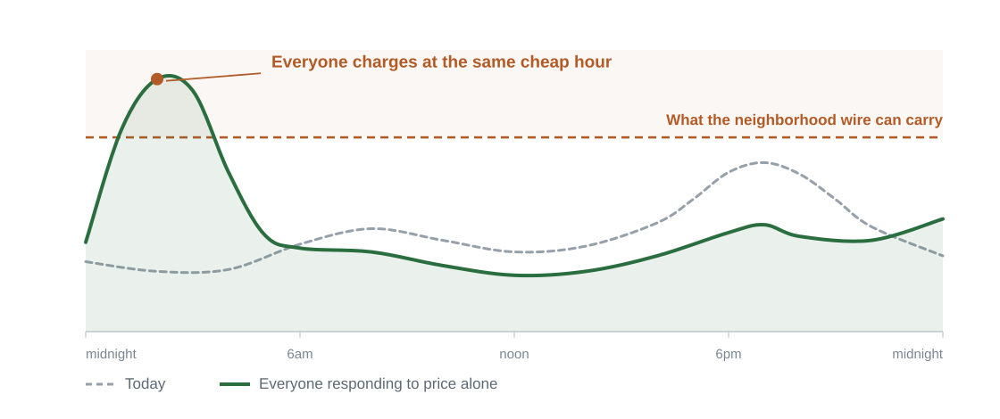
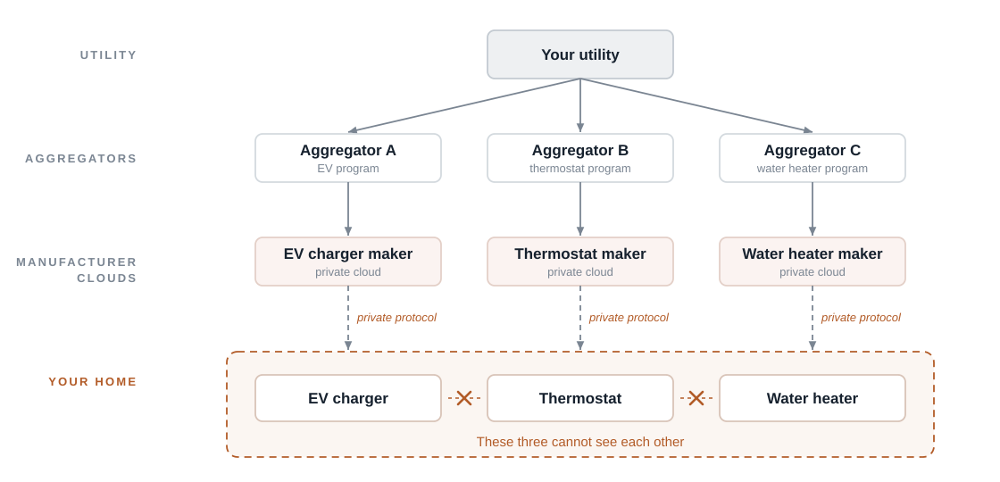
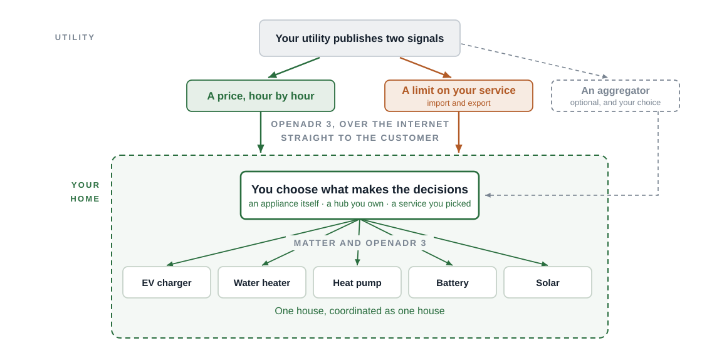
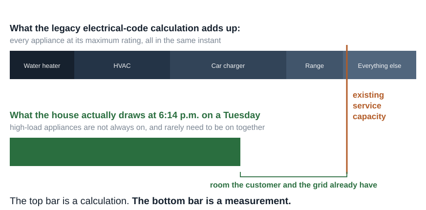
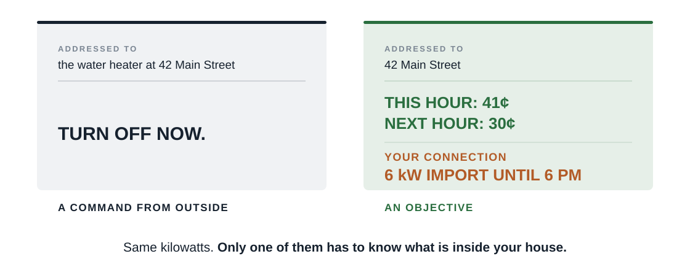
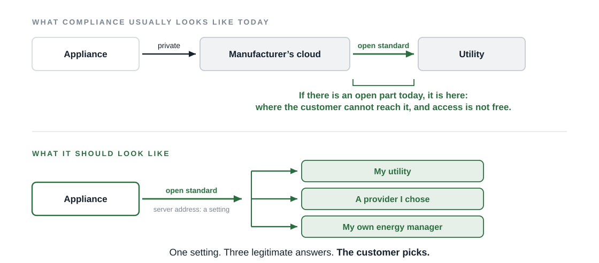

<!-- _class: alt -->
<!-- _paginate: false -->
<!-- _footer: "" -->

### Grid Coordination

# Two signals. Six tests.

The grid has two problems. Few proposals solve even one.

DC Jackson · grid-coordination.energy · November 2026

---

## The grid has two problems, and they are not the same problem

Balancing the grid is an economics problem. Protecting the transformer is a physics problem. **Both land on the bill.** [Peak we cannot shift](https://www.utilizecoalition.org/untapped-grid) is generation and transmission somebody has to build; a transformer we cannot protect is a street somebody has to dig up. Ratepayers fund both.

---

## Price balances the grid. It cannot see the transformer.

**Highly dynamic pricing is the right answer for balancing the grid, and the most important thing California is doing on demand flexibility.**

It should be pursued harder, not hedged. **Dynamic pricing reduces capacity problems. It cannot eliminate them**, because a price is shared by everyone on the same asset. It cannot stop five houses on one transformer responding to the same number at the same moment.

**That is why we also need a capacity limit.**

---

<!-- _class: dense -->

## We have always had static capacity limits. Dynamic limits are now possible.

| | Static | Dynamic |
| --- | --- | --- |
| **The size of the pipe** | The service rating: the panel, the main breaker, the conductors back to the transformer | The power a connection may import, and may export, right now |
| **It changes** | Once, when somebody digs up the street | Every interval, with a schedule ahead and a default to fall back to |
| **Who sets it** | The electrical code, at installation | The distribution utility, from what the shared transformer and conductors can carry |
| **Who enforces it** | A breaker. Since NEC 705.13, also a **UL 3141** power control system | The same **UL 3141** power control system |
| **How it arrives** | Built into the hardware | **This is the gap** |

**What makes them possible is already in place.** A UL 3141 power control system holds a whole site under a number, and D.26-02-025 put a dynamic limit into a California tariff. **The number has no way to reach the house.**

---

## Two signals: a price, and a capacity limit

|  | A dynamic price | A per-customer power limit |
| --- | --- | --- |
| **What it is** | What energy costs right now | How much power a connection may draw right now |
| **Scale** | The entire grid: hundreds of thousands of customers at once | The customers on one distribution transformer: five or six |
| **What it solves** | Balancing the grid | Protecting the transformer |
| **What it does** | Moves energy across time | Caps power, immediately |
| **Without it** | Nobody has a reason to shift | Nothing stops everyone shifting at once |

**These two can be adopted separately.** Different signals, different timescales, different failure modes.

---

## The limit is on the connection, not the device

- **One customer, one connection, one limit** (import and export). A modern home has solar, a battery, one or two car chargers, a heat pump and a heat pump water heater, all at once. The limit belongs on the wire, not on any one appliance.
- **Today we enroll one device at a time.** One thermostat program, one charger program, one inverter under IEEE 2030.5. A customer with all three is in three programs, none of which can see the other two.

**Every appliance a customer adds makes device-by-device coordination worse.** Control each one separately and nobody is managing the total impact to the transformer and distribution grid.

---

<!-- _class: dense2 -->

### To close on capacity

## One box enforces the limit. Everything else only needs the price.

- **Enforcement is one box's job.** The **UL 3141** power control system holds the whole site under the number, because that is the only place the whole site's draw is visible. Two enforcers would fight each other.
- **Every other appliance just reads a price.** A water heater, a heat pump, a dryer, a dishwasher: receive a price stream and shift. No capacity logic, no new vocabulary, nothing about transformers.
- **Some devices may want to know the limit anyway, and that is cheap.** An energy manager, an EV charger, a battery deciding when to export: each schedules better if it can see the limit, and none of them is responsible for holding the site under it. Knowing requires no listing. Enforcing does.
- **Where there is an energy manager, it takes the price. Where there is not, the appliance takes it directly.** Many homes will have no energy manager, especially in the near term, which is why the capability belongs in the appliance.
- **So the ask on an appliance vendor is two things, and they are the same for every product category.** Respond to a price, and support an open local control protocol so the house can reach it.

**The capacity signal has to exist, be published, and reach the house.**

---

<!-- _class: tight -->

### How it works today

## The problem with aggregators and manufacturer clouds Four companies must agree before one appliance flexes its demand

How can a customer's appliances and DERs be orchestrated when every one of them is controlled separately, and somewhere else?

And any of it can be switched off. On October 25, 2025 Google ended cloud support for first and second generation Nest thermostats: those homes lost every ability to respond to an outside signal, on a date the manufacturer chose.

---

### How it needs to work

## Grid: Both signals, one open protocol, direct to the customer Home: One open protocol for local appliance control and orchestration

**Most of this is running today, at pilot scale.** A [free, public server](https://github.com/grid-coordination/price-server-user-guide) carries real hourly California prices, and [free open-source software](https://github.com/grid-coordination/openadr3-ven-hass) receives it and orchestrates the house: no account, no contract, no enrollment. [PG&E is piloting dynamic capacity limits with AMI 2.0](https://www.canarymedia.com/articles/utilities/as-californians-electrify-tech-prevent-grid-overload).

---

## Six tests for any flexibility proposal

Rate designs, appliance standards, VPP programs, capacity and interconnection proposals. Every one of them will use the words <em>flexible</em>, <em>smart</em>, and <em>customer choice</em>. **Many of them also insert a new gatekeeper between the grid and the customer.**

1. Does the grid send the customer **an objective**, or does it **operate the appliance**?
2. Does the open interface reach **the appliance itself**, or stop at **the manufacturer's cloud**?
3. Can the customer choose **who optimizes their home**, including doing it themselves?
4. Can the customer take **the signals** **directly from their utility**, or is a **middleman required**?
5. Is **fail-safe behavior specified and mandated**: if the signal fails, is **a known default** held?
6. Does the customer **who cannot respond** end up better off, or worse?

---

<!-- _class: dense2 tight -->

### Turning to the CEC's own rulemakings

## FDAS should be one standard for all appliances, not one per appliance

We do not need OCPP for chargers, CTA-2045 for water heaters, AHRI 1380 for HVAC and IEEE 2030.5 for solar and storage: a protocol per appliance category, and a rulemaking behind each.

- **The Commission has built this shape before.** The Load Management Standards are one rule covering every large IOU, not a separate proceeding per utility. FDAS should be one rule covering every flexible appliance, not a separate proceeding per appliance.
- **Every one of them needs the same two facts, and only those two.** What power costs now and next, and how much this connection may draw. A water heater does not need a water heater vocabulary to know either one.
- **Grid to house: OpenADR 3.** One open protocol over the Internet carrying both facts, with the server address a setting the customer controls.
- **House to appliance: Matter.** The same two facts to every device in the building, whatever it is.
- **This is less regulation, not more.** Both protocols ship today. One capability written once, instead of a rulemaking per appliance forever, each going stale the day it is printed.

Every appliance in the house is wired to one electrical code. Nobody wrote a separate code for water heaters, and the signals that tell them what to do should arrive the same way.

---

<!-- _class: dense -->

### The FDAS pool controls ruling

## It fails essentially all of these tests

| The six tests | Verdict | Pool controls, Title 20 sections 1690 to 1697 |
| --- | --- | --- |
| **1. An objective, not operation** | Not met | The rule fixes the hours instead: 9 a.m. to 3 p.m., nothing automatic 4 to 9 p.m. |
| **2. Open to the appliance** | Barely | Open standards required for the **consent** functions only |
| **3. A server the customer chooses** | Not met | No customer-configurable server address |
| **4. Direct from the utility** | Not met | A vendor-exclusive, cloud-only design complies |
| **5. Specified fail-safe behavior** | Not met | No signal to interrupt: the rule hardcodes a clock |
| **6. The customer who cannot respond** | Met | Answered, by brute force, for as long as those stay the right hours |

**Thermostats, EV charging and home batteries have no rule text yet.** Pass the tests, and consolidate into a unified standard for all flexible demand appliances.

---

## What not to mandate

| If the rule says | What you will actually get |
| --- | --- |
| "Must support [named standard, 2019 edition]" | Compliance frozen at the state of the art in 2019, and a vendor incentive to do nothing further |
| "The manufacturer shall provide a grid interface" | A cloud interface. The appliance still speaks nothing open, and it dies when that cloud does |
| "Customers participate through a program administrator" | Every customer needs a third party's permission before they can help the grid |
| "Each inverter shall be controllable" | Five separate control paths into one house and nobody managing the total |
| "The appliance shall run between 9 a.m. and 3 p.m." | A load shape frozen into regulation. It cannot follow a price, cannot respect a limit, and cannot change when the grid does |

**Name the capability in the rule, and the standard in an appendix you can update without reopening the rule.** Write it at the appliance, not at somebody's server.

---

## Who needs to do what

#### CEC

One unified FDAS standard for all flexible demand appliances, instead of a rulemaking per appliance category.

Write the capability into it: read a price, respect a connection limit, over an open protocol the customer can repoint.

#### CPUC

Make the flexible connection open. The limit ordered in D.26-02-025 has to reach the customer machine-readable, with no enrollment and no intermediary.

Require every tariff filing to include a URPX rate plan, so any rate becomes a price stream.

Extend the standard offer beyond PG&E and SCE.

#### Utilities

Publish the limit and the price, via OpenADR 3. A flexible connection the customer signs is worth nothing until the number reaches the equipment in the house.

Require both signals of your suppliers, in the next procurement you write.

#### Appliance OEMs

Receive both. Read a price, respect a limit, and let the customer point the server somewhere else.

Ship it now. OpenADR 3 and Matter both do this today, and neither waits on a regulator.

Every one of these fits inside a proceeding that is already open, and uses a standard that already ships.

---

<!-- _class: alt -->
<!-- _paginate: false -->

### Backup

# Detail

---

## Today, electrifying a home means a service upgrade

**We charge customers for a peak that does not happen, because we have no way to promise that it will not.** And the upgrade answers only the customer's half of the problem: this house can electrify, and the shared transformer is handed more load to carry. Protecting that transformer means replacing it early. Both upgrades land in rates.

---

<!-- _class: dense2 -->

### Static capacity, and the one thing that has changed

## How a house electrifies past the rating of its own wire

- **The static limit is three numbers that have to agree.** The service conductors from the transformer, the main breaker, and the panel busbar. The house may not draw more, and a breaker makes sure of it.
- **A load calculation decides whether the new load may be installed at all.** NEC Article 220 adds up connected load with fixed demand factors and no knowledge of how that house actually behaves. A home adding a heat pump, a heat pump water heater, an induction range and EV charging can exceed its service on paper while never approaching it in practice.
- **NEC 705.13 and UL 3141 changed the answer.** A listed power control system actively holds the site below the existing rating, so the load behind it comes out of the load calculation. The customer electrifies on the conductors and the service feed already there.
- **California put that in a tariff.** D.26-02-025 excludes load managed behind a certified power control system from the connected load calculation.

**The number the power control system holds the house under is still static.** It enforces what it was configured with. The hardware that respects a limit is listed, shipping, and recognized by code. Nothing outside the house can move the limit.

---

## Test 1: send an objective, not a command

**A customer operating their own equipment, through a controller they chose, is exactly right.** What does not belong at the grid boundary is a grid party or a manufacturer holding that control instead.

PASSES an hourly price and a connection limit, published to everyone.
FAILS a program that needs the ability to command a named appliance in a named house.

**A price is a one-way number. A command is a key to somebody's house.**

---

## Tests 2, 3 and 4: open all the way to the appliance

PASSES the server address is a setting the owner can change, and a tariff any customer can take without a third party.
FAILS an appliance that meets the standard only through a cloud the manufacturer can switch off.

---

<!-- _class: dense2 -->

## Test 6: the customer who cannot respond

The first objection to hourly prices and per-customer limits is that the affluent optimize and everybody else gets rationed. It is the right question and it deserves the first answer, not the last.

| | To join a program today | To read a public signal |
| --- | --- | --- |
| **An enrollment** | Required | Nothing |
| **A credit relationship with a third party** | Required | Nothing |
| **A particular brand of device** | Usually | Any device that can reach the network |

- **Nobody should have to watch a price.** The appliance watches the price. The customer sets a preference once.
- **Many customers who cannot shift are paying today** for a grid sized to everyone else's worst hour. Capital spending that never enters rates is their benefit, and it is the largest one.
- **Dynamic pricing asks less of people than a virtual power plant does.** Everyone already pays for VPP incentives through rates. PNNL's DSO+T study found participants **and non-participants** both saw bills fall 10 to 16 percent.

---

<!-- _class: dark -->

### The Commission has already asked the question

> "What hardware, software, or data sharing safeguards may be needed to ensure that customers can obtain a flexible connection without being restricted by proprietary arrangements?"

Assigned Commissioner and ALJ ruling, July 7, 2026, seeking comment on the Assigned Commissioner's Proposal on Flexible Service Connections. Grid modernization rulemaking R.21-06-017, Question 8 to parties.

---

<!-- _class: dense2 -->

### Making the price signal reach every customer

## A time-of-use rate is a price stream with fewer changes

- **The signal carries what power costs now and over the coming hours.** A schedule, not a single number. That forward view is what lets a house plan ahead.
- **Highly dynamic pricing is the destination, and nothing has to wait for it.** A flat rate is a price stream with no changes at all. Same mechanism, same appliance, same software, whatever tariff the customer is on. The appliance never needs a tariff engine, only an interval consumer.
- **What that asks of the Commission:** require every tariff filing to include a machine-readable rate plan. The open **[Utility Rate Plan Exchange (URPX)](https://urpx.org)** standard, hosted by LF Energy, is built for exactly this, and ships worked test cases built from published PG&E and Con Edison filings. I am modeling California residential rate plans in it, in the open, at **[grid-coordination/urpx-rate-plans](https://github.com/grid-coordination/urpx-rate-plans)**.
- **And what it asks the Commission to retire:** tariff attributes a price stream cannot carry. A **demand charge** is the clearest example: it prices a peak after the fact, so no device can act on it from the signal alone.

Every customer can be served by the same mechanism today, whatever tariff they are on. The rate can get more dynamic later without touching a single appliance.

---

<!-- _class: dense -->

## Where California actually stands

| Driver | Where it stands |
| --- | --- |
| **CalFUSE** | CPUC staff framework, June 2022, for a single universally available dynamic price signal. A white paper name, not a decision or a program |
| **Load Management Standards** | Large IOUs: an hourly, marginal cost-based rate for every customer class by January 1, 2027. Large CCAs: that rate or a qualifying program by July 1, 2027 |
| **Rate design** | D.25-08-049, August 2025. Guidelines for designing demand flexibility rates; the rates themselves are still in testimony. Remaining issues moved to R.26-04-009, opened April 2026 |
| **Flexible service connections** | D.26-02-025, February 10, 2026. PG&E and SCE to establish a standardized tariffed flexible connection. Load behind a certified power control system is excluded from the connected load calculation |
| **Appliance standards** | One adopted: pool controls, September 29, 2025. It mandates a preconfigured schedule (1693(b)(2)(C)(1)) and open standards for the **consent** functions (1693(b)(6)(B)), but no ability to receive a price, a signal or a limit, and no customer-configurable server. Thermostats (24-FDAS-03), EV charging (24-FDAS-04) and home batteries (25-FDAS-01) are open dockets with no rule text |
| **Legislation** | AB 1787 held under submission in Senate Appropriations, August 13, 2026. The regulators are moving; the statute is not |

---

<!-- _class: dense2 -->

## Why some standards are hurting, not helping

- **CTA-2045, marketed as EcoPort.** Washington, Oregon, Colorado and New York require the socket on new electric water heaters. Nothing above it was ever standardized, so every vendor's module speaks its own language upstream, and the module a customer has to buy and install runs well over $150. **The open interface stops at the socket. The standard is obsolete and should be retired, not written into new rules.**
- **AHRI 1380.** The standard permits a local interface. **Virtually every AHRI 1380 product is cloud-only**, and AHRI certifies nothing against the standard.
- **IEEE 2030.5.** CSIP certifies aggregators and utility servers as well as inverters, but puts everything below the aggregator or site management system **out of scope**, so it stops at the edge of the house. One inverter is still the wrong unit for a house with solar, a battery and two bidirectional chargers: control each separately and nobody manages the total. **What belongs there is one import and export limit for the whole connection.**
- **OCPP.** Built for commercial and public EV charging. **Almost no** US residential chargers implement it, and controlling one from a local server is not required and almost never supported in shipping products. **There is no need for a protocol unique to EV chargers.**

**Two open standards already support every one of these principles, and both ship today.**

**[OpenADR 3](https://www.openadr.org/)** carries prices, events and limits from the utility to the customer's own equipment, **over the Internet**. The server address is the customer's setting.

**[Matter](https://csa-iot.org/all-solutions/matter/)** carries the same information to every device inside the house, **over the home network**.

---

<!-- _class: dense -->

### Where each signal is actually defined

## Both signals already have a named home on both hops

| | A price | A capacity limit |
| --- | --- | --- |
| **Grid to customer** | **OpenADR 3** | **OpenADR 3** |
| **Inside the building** | **Matter** and **OpenADR 3**. Matter carries it in the Commodity Price cluster | **Matter** and **OpenADR 3**. Matter carries it in the PowerThreshold feature of the Meter Identification cluster |

Everything above is already published. **The gap is not in the standards. It is that nobody is sending the limit.**

---

<!-- _class: dense2 -->

## The manufacturer's real objection, and the answer

- **What they say:** the cost of the parts, and a ten-year support obligation on a device they no longer control.
- **The customer already paid for the parts.** Every one of these appliances ships with a microcontroller and a Wi-Fi radio, on the customer's receipt. The customer still cannot talk to the thing they bought without going through the manufacturer.
- **What the closed path actually protects:** the customer relationship, the customer's usage data, and a share of whatever that customer's load shifting earns.
- **None of those three are theirs.** The usage data is private, and it belongs to the customer. The incentive is paid for the customer's forbearance, not for the manufacturer's software. And a customer-configurable server **reduces** the obligation they say worries them: they stop being the mandatory operator of a cloud service for the life of the appliance.

The hard part was never the technology. It is that nobody is required to open the door.

---

<!-- _class: dense2 -->

### Everything here is public and free

## Where to find all of this

| | |
| --- | --- |
| **This deck, and the one-page handout** | grid-coordination.energy/presentations |
| **The price server**, with client tutorials | github.com/grid-coordination/price-server-user-guide |
| **Home Assistant integration**, in the HACS default repository | github.com/grid-coordination/openadr3-ven-hass |
| **URPX rate plans for California**, a public corpus of modeled tariffs | github.com/grid-coordination/urpx-rate-plans |
| **Open-source libraries** (Clojure and Python) | github.com/grid-coordination |
| **My CEC docket comments** and the California policy record | grid-coordination.energy/policy |
| **OpenADR 3**, the grid-to-customer standard | openadr.org |
| **Matter**, the in-home standard | csa-iot.org |
| **URPX**, machine-readable tariffs, hosted by LF Energy | urpx.org |

No account, no contract, no enrollment on any of it. Every link in this deck is live and clickable in the PDF.

